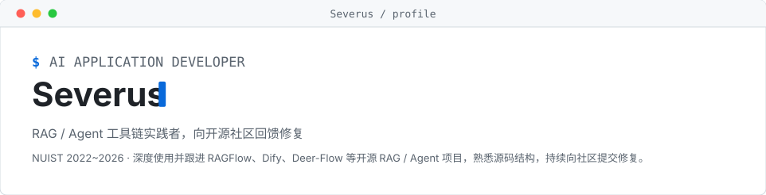

<picture>
  <source media="(prefers-color-scheme: dark)" srcset="./assets/hero-dark.svg">
  
</picture>

<!-- CONTRIB:BEGIN -->
<picture>
  <source media="(prefers-color-scheme: dark)" srcset="./assets/contrib-dark.svg">
  
</picture>
<!-- CONTRIB:END -->

## 代表作品

- **[RAGFlow 贡献](<https://github.com/infiniflow/ragflow>)**：已合并 2 个 PR：修复 skill space 对话框 i18n 缺失字符串（\#22111）、修正五份翻译版 README 的失效部署文档锚点（\#22128）。
- **[Dify 实践](<https://github.com/langgenius/dify>)**：跟进 Agentic workflow 与 RAG pipeline，本地部署与源码研读。
- **[Deer-Flow 贡献](<https://github.com/bytedance/deer-flow>)**：已合并 2 个 PR：声明前端所需的 Node/pnpm 版本（\#7952）、修复文档内部锚点（\#8007）。
